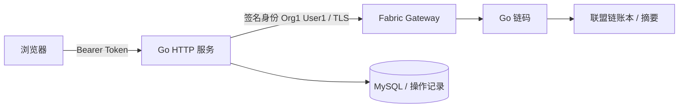

# 超级账本 Fabric 简易联盟链系统

企业级联盟链入门工程：Hyperledger Fabric + Go 链码 + Go Web + MySQL。
实现链上存证、按编号查询、组织级权限、链下操作日志，附中文控制台和 GitHub Actions。

> 本项目是学习工程，不是生产系统。单机部署采用官方 test-network：2 个组织、每组织 1 个 Peer、1 个 Orderer，均运行在同一台机器。它不是单 Peer 网络，也不具备多机容灾。没有部署真实网络时不会伪造链上数据。

## 结构

```text
chaincode/             独立 Go 模块，权限与不可覆盖存证
cmd/server/            HTTP API、鉴权、MySQL 日志与核对
internal/ledger/       Fabric Gateway Go 客户端、TLS 与签名身份
web/                   无构建依赖的中文控制台
db/schema.sql          MySQL 初始化表
scripts/network.sh     Fabric 官方测试网络安装引导与启动
compose.yaml           MySQL 8.4
.github/workflows/     两个 Go 模块的编译、测试与静态检查
```



## 前置环境

推荐 Ubuntu 22.04/24.04，或 Windows 的 WSL2 Ubuntu。需要 Go 1.24、Git、curl、Docker Engine / Docker Desktop（Linux containers）和 Docker Compose v2。Windows 用户请在 WSL2 内克隆并运行，Docker Desktop 开启该发行版的 WSL 集成；不要用 PowerShell 执行 Bash 脚本。建议预留 8GB 内存和 15GB 磁盘。

## 启动

在项目根目录依次执行：

```bash
# 1. 下载官方安装脚本，阅读后安装固定版本的镜像、样例和二进制
bash scripts/network.sh install
cd network
less install-fabric.sh
bash install-fabric.sh --fabric-version 2.5.12 --ca-version 1.5.15 docker samples binary
cd ..

# 2. 安装两个模块的 Go 依赖；go.sum 已纳入版本控制
go mod download
(cd chaincode && go mod download)

# 3. 建网络、通道并部署 evidence 链码
bash scripts/network.sh up

# 4. 配置密码和令牌
cp .env.example .env
# 用编辑器修改 .env 中所有 replace-* 占位值
# API_TOKEN 至少 32 字符，建议 openssl rand -hex 32
# MYSQL_DSN 中密码必须与 MYSQL_PASSWORD 相同
set -a
source .env
set +a

# 5. 启动数据库（首次启动自动导入 db/schema.sql）
docker compose up -d --wait

# 6. 启动真实 Fabric 后端
go run ./cmd/server
```

打开 <http://127.0.0.1:8080>，输入 `.env` 中的 API_TOKEN。依次填写存证编号、标题、内容，提交后再按同一编号查询。页面仅在内存中保存令牌，刷新后需要重新输入。

后端默认从 `network/fabric-samples/test-network/organizations/peerOrganizations/org1.example.com` 读取 User1 的证书和私钥。可通过 `FABRIC_ORG_PATH` 修改根目录；`FABRIC_PEER_ENDPOINT` 默认 `localhost:7051`，`FABRIC_CHANNEL` 默认 `mychannel`。后端身份固定为 Org1；不要把目录中的身份文件提交到 GitHub。

## API

除 `/healthz` 和静态文件外，所有 API 均要求 `Authorization: Bearer <API_TOKEN>`。

| 方法 | 路径 | 说明 |
|---|---|---|
| POST | `/api/evidence` | JSON：id、title、content；后端计算 SHA-256 后上链 |
| GET | `/api/evidence/{id}` | 查询真实账本并写入查询日志 |
| GET | `/api/operations` | 最新 50 条操作日志 |
| POST | `/api/reconcile` | 核对最多 100 条待确认提交记录 |
| GET | `/healthz` | 进程存活检查，不代表 Fabric 或 MySQL 就绪 |

```bash
curl -sS http://127.0.0.1:8080/api/evidence \
 -H "Authorization: Bearer $API_TOKEN" -H 'Content-Type: application/json' \
 -d '{"id":"CONTRACT-001","title":"采购合同","content":"合同版本 v1"}'
curl -sS http://127.0.0.1:8080/api/evidence/CONTRACT-001 \
 -H "Authorization: Bearer $API_TOKEN"
curl -sS http://127.0.0.1:8080/api/operations \
 -H "Authorization: Bearer $API_TOKEN"
```

## 权限与存证语义

- Org1MSP 可写入与查询，Org2MSP 只可查询，其他组织拒绝。权限由链码根据签名身份校验，不能通过 HTTP 参数伪造组织。
- 一个 API_TOKEN 对应一个后端服务身份，不是多人用户登录或企业 RBAC。共享令牌不能区分具体操作人。
- 编号 1–64 位 ASCII 字母、数字、下划线、连字符；标题最多 240 UTF-8 字节；HTTP 请求体最多 64KiB。
- 存证不可修改、不可删除；并发同编号写入由 Fabric MVCC 冲突校验保证最终不会覆盖已有状态。
- 链上保存 SHA-256、标题、创建者证书身份、MSP、交易号和提案时间。原文不会持久化到 MySQL；原文仍会经 HTTP 到达 Go 服务，用于计算摘要。标题和摘要对通道成员可见，不要提交敏感标题。
- `created_at` 是 Fabric 提案时间的 Unix 秒字符串，不是可信第三方授时或法律效力证明。自行保存原文，按精确 UTF-8 字节计算 SHA-256 核验；空格和换行变化会改变摘要。

## 链上/链下一致性

MySQL 与 Fabric 没有分布式原子事务。服务先写 `PENDING` 意图再发交易；成功确认后写 `COMMITTED` 和交易号。交易报错或超时记为 `UNKNOWN`，不能据此断言链上失败。链上成功但日志更新失败返回 HTTP 202 并提示核对。

`POST /api/reconcile` 在链上按编号查询待确认记录，存在时标记 `FOUND_ON_CHAIN`。此状态仅证明该编号已存在，可能是更早的同编号请求，不能当成该次提交成功；未找到或网络错误则保留待核对状态。进程崩溃留下的 `PENDING` 也可核对。生产扩展需增加每次请求的幂等键、持久化交易号和事件消费，而不是直接自动重试未知交易。

## 验证

```bash
go test -race ./...
go vet ./...
go build ./...
(cd chaincode && go test -race ./... && go vet ./... && go build ./...)
node --check web/app.js
```

真实网络验收：提交一条存证 → 查询摘要与交易号 → 再次提交同编号应被拒绝且原存证不变 → 刷新 MySQL 日志 → 停止 MySQL 后写入应返回 503 且不发送交易 → 恢复 MySQL → 停止 Fabric 后查询应返回 502。链码测试涵盖 Org2 写入拒绝、未知组织拒绝、查询与重复编号。

## 停止、重启和数据

Ctrl+C 停后端；`docker compose stop` 停 MySQL 并保留数据。再次运行 `docker compose up -d --wait` 与 `go run ./cmd/server`。

`bash scripts/network.sh down` 会清理测试网络账本和身份，请仅在确定要重置时运行。MySQL 卷仍保留，因此网络重置后日志可能对应旧账本；请明确记录演示环境的重置边界。不要用删除卷命令来“修复”数据库连接问题。修改 schema 后，已有数据库不会自动重新导入初始化 SQL。

## 发布到公开 GitHub

建议仓库名 `fabric-simple-ledger`，描述“超级账本 Fabric 简易联盟链系统｜Go + MySQL 企业联盟链入门工程”。

1. 登录由账号本人在 GitHub 网页或 `gh auth login --web` 中完成，不向聊天提供密码、验证码或访问令牌。
2. 创建 Public 空仓库，不勾选自动创建 README。
3. 检查 `git status`，确保 `.env`、证书、私钥、网络生成目录均未被跟踪。
4. 按 GitHub 空仓库页面给出的命令设置 remote 并推送 main 分支。

项目使用 MIT 协议。Go 模块路径已配置为 `github.com/Fpx0325/fabric-simple-ledger`。

## 参考

- [Fabric 官方 test-network 文档](https://hyperledger-fabric.readthedocs.io/en/latest/test_network.html)
- [Fabric Gateway Go 客户端](https://github.com/hyperledger/fabric-gateway/tree/main/pkg/client)
- [Fabric 官方应用开发教程](https://hyperledger-fabric.readthedocs.io/en/latest/write_first_app.html)

Gateway 是 Fabric 2.4+ 推荐的应用接入方式，本工程使用 Gateway Go SDK，不使用旧版 fabric-sdk-go。
